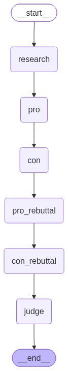
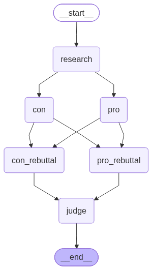
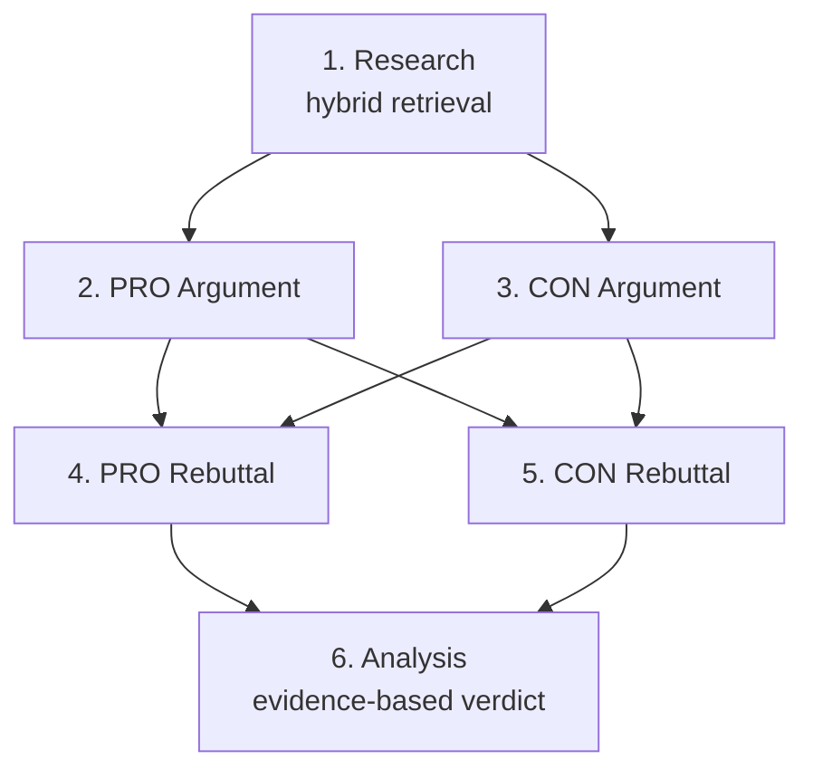

# 🧠 RAG-Grounded Multi-Agent Debate Engine

A RAG-powered multi-agent debate system built on a **6-node LangGraph workflow**. Given a topic, it researches a PDF knowledge base, has **PRO** and **CON** agents argue and rebut each other, and produces an **evidence-based analysis**, with every claim grounded in retrieved passages and traceable to a **page-level source**.


---

## ✨ Key Features

- **Grounded debate**: arguments are built from retrieved evidence, not from the model's memory alone
- **Hybrid retrieval pipeline**: multi-query expansion, dense + BM25 search, Reciprocal Rank Fusion, and cross-encoder reranking
- **Traceable outputs**: page-level metadata and Pydantic-validated structured outputs, so each argument links back to its source
- **Parallel DAG execution**: PRO and CON agents run concurrently (fan-out / fan-in), cutting the critical path from 6 stages to 4
- **Swappable LLM backends**: switch between Gemini (cloud) and Ollama (local)
- **Pluggable reranker**: Cohere or a local Hugging Face cross-encoder
- **Live Streamlit UI** with real-time progress tracking for each node

---

## 🏗️ Architecture

### Evolution: Sequential MVP → Parallel DAG

The project started as a linear chain, where each of the 6 steps waited on the previous one. I re-architected it into a fan-out/fan-in graph so the PRO and CON agents work at the same time.

| MVP: sequential chain | Final: parallel fan-out / fan-in DAG |
|:---:|:---:|
|  |  |
| 6 stages on the critical path | 4 stages on the critical path |

### Workflow



### Nodes

| # | Node | Responsibility |
|---|------|----------------|
| 1 | **Research** | Expands the topic into multiple queries and retrieves + reranks evidence from the knowledge base |
| 2 | **PRO Argument** | Builds the case in favor, citing retrieved passages |
| 3 | **CON Argument** | Builds the case against, citing retrieved passages (runs in parallel with PRO) |
| 4 | **PRO Rebuttal** | Counters the CON arguments using the evidence |
| 5 | **CON Rebuttal** | Counters the PRO arguments using the evidence (runs in parallel with PRO Rebuttal) |
| 6 | **Analysis** | Weighs both sides and produces the final evidence-based analysis |

> **Critical path:** Research → Arguments (parallel) → Rebuttals (parallel) → Analysis = **4 stages** instead of 6.

---

## 🔍 Retrieval Pipeline

```
PDFs ──► chunking + page metadata ──► ChromaDB
                                          │
Topic ──► multi-query expansion ──┬──► Dense (embeddings) ──┐
                                  └──► BM25 (keyword)  ─────┤
                                                            ▼
                                            Reciprocal Rank Fusion
                                                            ▼
                                            Cross-encoder reranking
                                                            ▼
                                            Top-k evidence + page refs
```

- **Multi-query expansion** improves recall by rephrasing the topic several ways
- **Dense + BM25** combines semantic similarity with exact keyword matching
- **RRF** merges the two ranked lists without needing to calibrate their scores
- **Cross-encoder reranking** rescoring puts the most relevant passages first
- **Page-level metadata** lets every cited claim point to its source PDF and page

---

## 🛠️ Tech Stack

| Layer | Tools |
|-------|-------|
| Language | Python |
| Orchestration | LangChain, LangGraph |
| LLMs | Google Gemini, Ollama (local) |
| Vector store | ChromaDB |
| Reranking | Cohere Rerank, Hugging Face cross-encoders |
| Validation | Pydantic |
| UI | Streamlit |

---

## 📁 Project Structure

```
├── app.py                    # Streamlit app entry point
├── src/                      # Graph, agents, retrieval logic
├── scripts/                  # Ingestion scripts (PDF → ChromaDB)
├── data/documents/           # Source PDFs for the knowledge base
├── chroma_db/                # Persisted vector store
├── tests/                    # Test suite
├── .env.example              # Environment variable template
├── requirements.txt
├── Initial_debate_graph.png  # Sequential MVP graph
└── debate_graph.png          # Parallel DAG graph
```

---

## 🚀 Getting Started

### 1. Clone the repository

```bash
git clone https://github.com/k-rajat42/RAG-Grounded-Multi-Agent-Debate-Engine-.git
cd RAG-Grounded-Multi-Agent-Debate-Engine-
```

### 2. Create a virtual environment and install dependencies

```bash
python -m venv venv
source venv/bin/activate        # Windows: venv\Scripts\activate
pip install -r requirements.txt
```

### 3. Configure environment variables

```bash
cp .env.example .env
```

Open `.env` and add your keys (see `.env.example` for the exact names), for example:

```env
GOOGLE_API_KEY=your_gemini_key
COHERE_API_KEY=your_cohere_key   # only needed if using the Cohere reranker
```

> Using **Ollama**? Install it from [ollama.com](https://ollama.com), pull a model (e.g. `ollama pull llama3`), and select Ollama in the app. No API key needed.

### 4. Add documents and build the knowledge base

Put your PDFs in `data/documents/`, then run the ingestion script:

```bash
python scripts/<your_ingest_script>.py
```

### 5. Launch the app

```bash
streamlit run app.py
```

---

## 🎬 Usage

1. Open the Streamlit app in your browser
2. Choose your LLM backend (Gemini / Ollama) and reranker
3. Enter a debate topic or motion
4. Watch each node complete live as the graph executes
5. Review the PRO and CON arguments, rebuttals, and final analysis, with cited sources and page numbers

---

## 🧪 Tests

```bash
pytest tests/
```

---

## 🗺️ Future Improvements

- [ ] Add a judge panel with multiple evaluator agents
- [ ] Multi-round debates
- [ ] Groundedness / faithfulness evaluation metrics
- [ ] Support for non-PDF sources (web pages, docs)

---

## 👤 Author

**Rajat**
GitHub: [@k-rajat42](https://github.com/k-rajat42)
